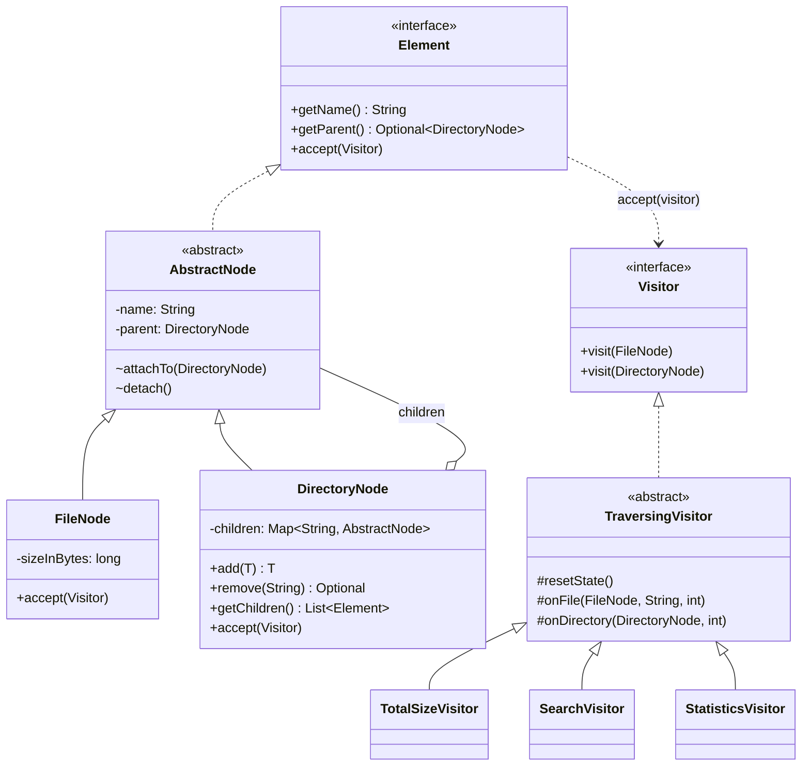

# Assignment 06 – Visitor Pattern: In-Memory File System

**Student:** Nursultan Nurislam · **Group:** SE-2538 · **Course:** ShP-2216 Software Design Patterns, Astana IT University

A small Java 17 / Maven project that models a hierarchical file system (files and directories) and runs three
independent operations over it with the **Visitor** pattern and double dispatch: total size, filtered search and tree statistics.
Covered by 40 JUnit 5 tests.

## How to run

```bash
# run the automated tests (from the project root)
mvn test

# run the deterministic demonstration
mvn -q compile exec:java
```

Requires JDK 17+ and Maven 3.8+. Expected test result: **40 tests, 0 failures, 0 errors**.

## Project structure

```
src/main/java/edu/aitu/fs/
├── Element.java                 common element interface (accept)
├── Visitor.java                 visit(FileNode) / visit(DirectoryNode)
├── AbstractNode.java            name + parent bookkeeping (parent writable only in-package)
├── FileNode.java                leaf, non-negative size
├── DirectoryNode.java           composite, enforces all tree invariants
├── NameValidator.java           legal-name rules
├── TreeIntegrityException.java  single exception for rejected mutations
├── Main.java                    demo
└── visitor/
    ├── TraversingVisitor.java   traversal owner + run lifecycle (base class)
    ├── TotalSizeVisitor.java
    ├── SearchVisitor.java
    └── StatisticsVisitor.java   added last, no change to elements
src/test/java/edu/aitu/fs/       6 test classes, 40 tests
```

## UML



## Design decisions

### Double dispatch (R2)
1. `element.accept(visitor)` – the runtime type of the **element** picks the body of `accept`.
2. `FileNode.accept` calls `visitor.visit(this)`, where `this` has the static type `FileNode`, so the
   compiler picks `visit(FileNode)`; `DirectoryNode.accept` likewise picks `visit(DirectoryNode)`.
   The runtime type of the **visitor** then picks the implementation.

There is no `instanceof`, `getClass()`, reflection or cast anywhere to choose behaviour per element type.

### Traversal owner (R7): the visitors
Elements only dispatch (`accept` calls exactly one `visit`). Descending is done by the common base
class `TraversingVisitor`: in `visit(DirectoryNode)` it calls `child.accept(this)` for every child.

*Why:* the elements stay minimal and never change when a new operation appears (R8), and depth/path
context lives in one place. *Trade-off:* each visitor must extend the base class (or re-implement
traversal) to walk the tree; a visitor that implements `Visitor` directly sees only the one node it
was given (this is exactly what the dispatch tests exploit).

Guarantees: pre-order, children sorted by name, every reachable node visited exactly once per run;
empty and arbitrarily nested directories are supported.

### Paths and depth
* Root has depth 0, its children depth 1, etc. Max depth includes files (`project/src/A.java` → 2).
  An empty root directory and a lone file root both give depth 0.
* A node's path = names of directories *below* the root + the node's name, joined with `/`.
  The root's own name is not part of any path; a file used as root is reported by its own name.
* Search results are sorted with `String.compareTo` (lexicographic by UTF-16 code unit).

### State control
A *run* starts when `accept` is called on a node while the visitor is idle. At that moment
`resetState()` and the path stack are cleared, so **visitor instances are reusable**, results never
accumulate across runs and never depend on run order. Results remain readable after a run until the
next run starts. Visitors are not thread-safe; use one instance per thread. The state is consistent
even if a run is aborted by an exception (`finally` blocks).

### Tree integrity (R6)
All checks run in `DirectoryNode.add` *before* anything is changed (failed calls leave the tree intact),
and all violations throw `TreeIntegrityException`:

| Rule | Where |
|------|-------|
| negative file size | `FileNode` constructor |
| blank / `/`-containing / `.` / `..` names | `NameValidator` |
| duplicate sibling name (file or dir) | `DirectoryNode.requireAddable` (children keyed by name) |
| multiple parents | `child.getParent().isPresent()` → rejected; use `remove(name)` to move |
| cycles | `wouldCreateCycle` walks the ancestors of the target directory |

Encapsulation: `getChildren()` returns an unmodifiable snapshot; `attachTo/detach` are package-private.

### Extension boundary (R8)
`Element`, `Visitor`, `FileNode`, `DirectoryNode` (incl. both `accept` methods) are the closed
contract. Adding `StatisticsVisitor` touched **only** new files (`StatisticsVisitor.java` and its test) –
see the git history, where it is a separate commit. New *operations* = new visitor class, no edits to
elements. New *element types* are the opposite (see trade-off below).

### Trade-off: adding a new element type
Adding e.g. `SymlinkNode` forces a new `visit(SymlinkNode)` method in `Visitor`, so **every** existing
visitor (and the base class) must be changed and recompiled. Visitor makes new operations cheap and new
element types expensive – it fits stable element hierarchies with many evolving operations.
Conversely, if element types change often, plain polymorphic methods on the elements are better.

## Clean Code practices used

| # | Practice | Where | Justification |
|---|----------|-------|---------------|
| 1 | Meaningful naming | `TotalSizeVisitor.getTotalBytes`, `SearchVisitor.nameEndsWith`, `DirectoryNode.wouldCreateCycle` | Names state intent and unit, so code reads without comments. |
| 2 | Single Responsibility | `NameValidator` (naming rules), `TraversingVisitor` (walking/paths), `TotalSizeVisitor` (summing only) | Each class has exactly one reason to change. |
| 3 | Small methods | `DirectoryNode.requireAddable`, `TraversingVisitor.enter/leave`, `SearchVisitor.isMatch` | Short, single-purpose methods are easy to test and trace. |
| 4 | Encapsulation | `DirectoryNode.getChildren` (unmodifiable copy), package-private `attachTo/detach` | Invariants can only be changed through validated public methods. |
| 5 | No type-checking chains | `FileNode.accept` / `DirectoryNode.accept` | Overload resolution replaces `if (x instanceof …)` chains. |

## Tests (JUnit 5, `mvn test`)

| Class | Tests | Covers |
|-------|-------|--------|
| `DoubleDispatchTest` | 3 | T1 – both elements reach the correct overload |
| `TotalSizeVisitorTest` | 5 | T2 – multi-level sums, subtree, empty, zero-byte files |
| `SearchVisitorTest` | 9 | T3, T4, T6 – name+size filter, inclusive threshold, root-relative sorted paths, no match, empty |
| `StatisticsVisitorTest` | 6 | T5, T6 – counts, max depth, empty/file root, repeat runs |
| `TreeIntegrityTest` | 12 | T8 – negative size, duplicates, 2nd parent, cycles, read-only children, valid deep nesting & move |
| `VisitorStateTest` | 5 | T7 – repeated runs do not leak or multiply state |

Result: **40 tests, 0 failures, 0 errors, 0 skipped.**

## Sample output (`mvn -q compile exec:java`)

```
=== Tree ===
project/
  README.md (1200)
  docs/
  pom.xml (2400)
  src/
    Main.java (3100)
    Util.java (800)
    model/
      User.java (1500)
      generated/
        Schema.java (9000)

=== TotalSizeVisitor ===
Total size: 18000 bytes

=== SearchVisitor (name ends with .java, size >= 1000) ===
  src/Main.java
  src/model/User.java
  src/model/generated/Schema.java

=== StatisticsVisitor ===
Files: 6
Directories: 5
Max depth: 4

=== Reuse check: same visitor, second run ===
Total size again: 18000 bytes (no accumulation)

=== Invalid mutation ===
Rejected: Duplicate sibling name: README.md
```

## Sources
Lecture 9 (Visitor Pattern); Freeman & Robson, *Head First Design Patterns*, 2nd ed.; Refactoring.Guru – Visitor.
